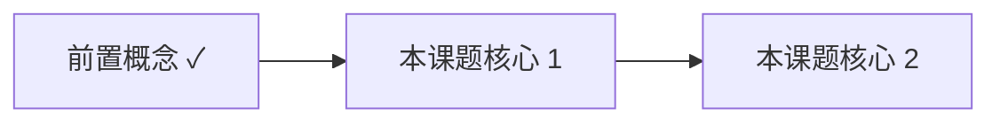

# {{TITLE}}

目标: {{GOAL}}
关联: {{ROADMAP}}
来源: {{SOURCES}}
状态: 进行中

## 依赖图

## 课程（每一步 = 一节 HTML 课）

- [ ] 1. {{STEP1}} — 掌握标志: （可观察的能力，非强制考核）

## 复习

<!-- 复习后由 course.py reviewed 追加一行：- YYYY-MM-DD 复习 第 a–b 课 -->
