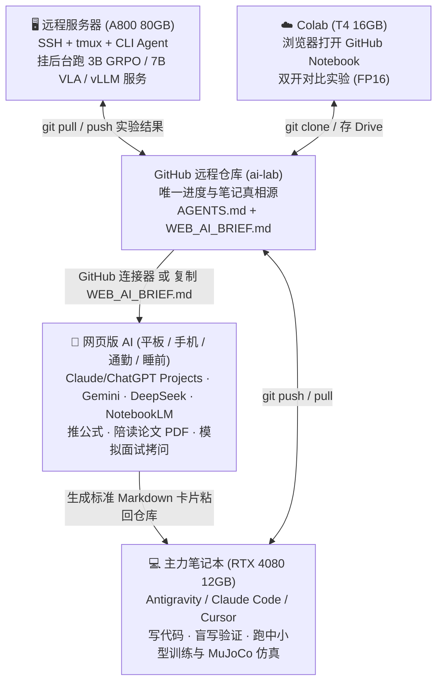

# 🌐 多设备 + 本地 Agent + 网页版 AI 协同学习全攻略

> **结论先行**：把当前 `lab/` 作为独立仓库推送到你的 GitHub，配合本地 IDE Agent、远程 A800 和网页版 AI（ChatGPT / Claude / Gemini / DeepSeek / NotebookLM）一起学习，**不仅合适，而且是目前最高效的多端 AI 学习架构**。

---

## 一、 为什么「推上远程 + 网页版 AI」非常合适？怎么分工？

不同终端在一天中的认知负荷完全不同，切忌在手机上看报错，也别坐在 4080 电脑前干读长论文：



---

## 二、 推送远程前的 3 个安全与隐私细节（必看！）

1. **仓库设 Public（公开）还是 Private（私有）？**
   - **推荐方案：设为 Public（公开）**，名字建议叫 `llm-agent-embodied-lab` 或 `embodied-ai-journey`。
   - **好处 ①**：许多网页端 AI（Gemini、开启联网的 ChatGPT/DeepSeek、GitHub 直连工具）可以直接通过公开 URL 读取你的 `AGENTS.md`、`WEB_AI_BRIEF.md` 和代码；
   - **好处 ②**：持续 16 周的真实 commit 记录、盲写代码和实验表格本身就是 **27 届实习简历上最有说服力的 GitHub 绿墙证明**！
   - *注*：如果你在 Claude Projects / ChatGPT Plus 里授权了 GitHub Connector，设为 **Private** 也能直接挂载读取，按个人喜好选择即可。
2. **绝对不提交敏感信息（已配置 `.gitignore` 保护）**
   - API Key 统一写在本地环境变量或 `.env`（已被 `.gitignore` 忽略）；
   - 远程 A800 的服务器 IP、用户名写在 `~/.bashrc` 或 `env/sync_a800.local.sh`（`*.local.sh` 已被 `.gitignore` 忽略）；
   - 若仓库公开，`career/interview_log.md` 中记录真题时用「某大厂 A / 具身初创 B」代替真实公司名，避免保密争议。
3. **只推 `lab/`，不推上层 `autumn-recruitment`**
   - `lab/` 已经是独立的 Git 仓库，体积轻巧（不含大图片包和 23 个无关目录），网页版 AI 读取时上下文极度干净，不会消耗多余 Token！

---

## 三、 第一次推送到你自己的 GitHub（30 秒搞定）

1. 在 GitHub 网页新建一个**空白仓库**（不要勾选 Initialize with README），例如 `ai-lab`。
2. 在本机终端执行：
   ```bash
   cd /mnt/study/github/autumn-recruitment/lab

   # 生成最新的网页端 AI 交接简报
   python3 study.py brief

   # 提交并推送到你的远程库
   git add .
   git commit -m "init: 16-week LLM + Agent + Embodied AI learning lab & AI constitution"
   git branch -M main
   git remote add origin https://github.com/ysysysy123/lab.git
   git push -u origin main
   ```
   > 💡 **多设备小贴士**：在你的主力笔记本上，直接在 IDE 里用 **`File -> Open Folder` 打开 `/mnt/study/github/autumn-recruitment/lab` 作为工作区根目录**，这样 `.agents/skills/` 下的 4 个专属 AI 技能（苏格拉底教学、论文陪读、模拟面试、多端同步）和 `AGENTS.md` 会被全部自动挂载！

---

## 四、 各大网页版 AI 的最佳接入姿势

### 姿势 A：Claude Projects / ChatGPT Projects（强烈推荐）
1. 新建一个 Project，命名为 `27届 LLM+Agent+具身冲刺`。
2. **Project Instructions（自定义指令）**：直接把本仓库的 `AGENTS.md` 全文复制进去。
3. **Project Knowledge（知识库）**：
   - 若支持 **GitHub 连接器**：直接绑定你的 `ai-lab` 仓库，勾选 `ROADMAP_16W.md`、`WEB_AI_BRIEF.md`、`papers/READING_LIST.md` 和正在做的 `projects/pX`。
   - 若手动上传：每周更新一次 `WEB_AI_BRIEF.md` 拖进去即可。

### 姿势 B：手机端临时对话（DeepSeek / Gemini / 网页新窗口）
每次在电脑上收工准备离开座位前，敲一行：
```bash
python3 study.py brief && git commit -am "chore: sync daily progress" && git push
```
它会刷新根目录下的 **`WEB_AI_BRIEF.md`**（不到 100 行，浓缩了你的助教规则 + 当前第几周 + 已完成打勾数 + 今日待办 + 4 套一键提问词）。在手机上打开任何网页 AI，把 `WEB_AI_BRIEF.md` 粘贴过去，**3 秒钟就能接着电脑上的进度继续推公式或背面试题！**

### 姿势 C：Google NotebookLM（通勤听播客神器）
把本周要精读的 1–2 篇英文论文 PDF（如 *Attention Is All You Need*、*Diffusion Policy*）连同你的 `WEB_AI_BRIEF.md` 一起传进 NotebookLM，点击生成中文/双语播客音频或思维导图，走路吃饭时先把论文脉络听熟，晚上回电脑前 30 分钟就能填完论文卡片！

---

## 五、 跨设备「开机 — 收工」标准三步曲

1. **任何设备开机坐下**：
   ```bash
   git pull
   python3 study.py status
   ```
2. **学习过程中**：
   - 在本机 / A800：直接让 IDE Agent 配合你写代码、做盲写测试（它会自动遵守 `AGENTS.md`）；
   - 在平板 / 网页端：聊完一篇论文后，对网页 AI 说：*「请严格按我仓库 `_template_deep.md` 的 Markdown 源码格式总结刚才的讨论」*，复制回来存进 `papers/`。
3. **收工离开当前设备**：
   ```bash
   python3 study.py brief
   git add . && git commit -m "study(w01): ..." && git push
   ```

