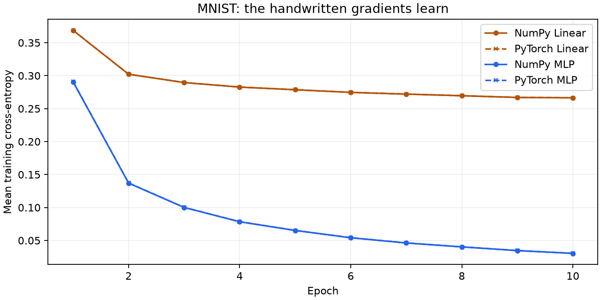
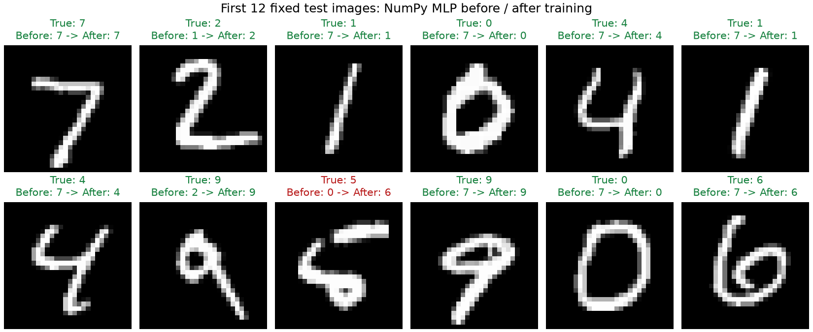

# MNIST 实战：NumPy → PyTorch → 验收

日期：2026-11-05。已实跑完成，可按下面三步重现。每次只看一步即可。

## 第一步：让 NumPy 模型学起来

在仓库的 `lab/` 目录运行：

```bash
OPENBLAS_NUM_THREADS=2 OMP_NUM_THREADS=2 ~/Apps/miniconda3/envs/test/bin/python projects/p1-tiny-llm/src/w01_mlp_mnist.py --mode numpy --model mlp --debug
```

这会用 640 张训练图片做 5 次参数更新，用 256 张测试图片评估，并保存、重新加载模型。快速试跑的目标是检查流程；正式准确率见第三步。

一次参数更新是：

```python
loss = model.train_step(x.numpy(), y.numpy())
```

`train_step` 内部完成：前向预测 → 交叉熵损失 → 七行反向传播 → SGD 更新。
`batch_size=128` 表示每批看 128 张图；`epoch=1` 表示把训练数据完整看一遍。

完整训练：

```bash
OPENBLAS_NUM_THREADS=2 OMP_NUM_THREADS=2 ~/Apps/miniconda3/envs/test/bin/python projects/p1-tiny-llm/src/w01_mlp_mnist.py --mode numpy --model mlp --epochs 10
```

本次 NumPy MLP 的平均训练损失从 0.29058 降到 0.03044。这两个数是第 1 轮、第 10 轮的平均值。



看蓝线：同一套参数不断更新后，模型在训练图片上的预测逐渐改善。NumPy 与 PyTorch 的曲线接近重合。

## 第二步：把手写梯度对应到 PyTorch

```python
optimizer.zero_grad()       # 清掉上一批留下的梯度
logits = model(x)            # 前向预测，输出 10 个原始分数
loss = criterion(logits, y)  # 算交叉熵
loss.backward()             # 自动算出梯度，对应 NumPy 的七行反向传播
optimizer.step()            # 更新权重，对应 W -= lr * dW
```

`CrossEntropyLoss` 直接接收原始分数，模型末尾不需要再加 Softmax。
NumPy 使用减去每行最大值后的 Log-Sum-Exp 计算损失，避免先算极小概率再取对数；梯度仍为 `(P-Y)/B`。

```bash
OPENBLAS_NUM_THREADS=2 OMP_NUM_THREADS=2 ~/Apps/miniconda3/envs/test/bin/python projects/p1-tiny-llm/src/w01_mlp_mnist.py --mode torch --model mlp --epochs 10
```

本次 PyTorch MLP 的平均训练损失从 0.29105 降到 0.03051，测试准确率为 97.71%。

## 第三步：用独立测试图片验收

统一设置：训练集 60,000 张、测试集 10,000 张；batch size 128；SGD 学习率 0.1；10 轮；随机种子 42。
各后端使用相同初始权重及每轮样本顺序。NumPy 参数为 float64；PyTorch 使用 RTX 4080 Laptop GPU、BF16 混合精度训练与 FP32 参数/评估。
测试集只在训练结束后用于完整准确率评估；另外保留固定前 12 张图片的训练前后预测。

| 后端 | 模型 | 训练损失：第1轮 → 第10轮 | 测试正确数 | 测试准确率 | 训练耗时(s) | 训练样本/s | 峰值GPU分配(MiB) |
|---|---|---|---|---|---|---|---|
| NumPy | Softmax 回归 784→10 | 0.36868 → 0.26642 | 9,226/10,000 | 92.26% | 2.72 | 220,848 | 0.00 |
| PyTorch | Softmax 回归 784→10 | 0.36868 → 0.26645 | 9,228/10,000 | 92.28% | 4.61 | 130,207 | 21.16 |
| NumPy | MLP 784→128→10 | 0.29058 → 0.03044 | 9,773/10,000 | 97.73% | 5.13 | 116,993 | 0.00 |
| PyTorch | MLP 784→128→10 | 0.29105 → 0.03051 | 9,771/10,000 | 97.71% | 4.65 | 129,084 | 22.81 |

两种 MLP 均达到 97% 的验收目标；逻辑回归作为线性基线。
训练耗时包括各轮数据加载与参数更新，排除初次数据准备、最终评估及模型保存。GPU 显存为 PyTorch 分配峰值，不是整卡总占用。



这些图片没有参与训练。第 9 张图片的真实标签是 5，两种 MLP 都预测为 6；完整测试集中的错误也计入上表。

一键复现四组实验：

```bash
OPENBLAS_NUM_THREADS=2 OMP_NUM_THREADS=2 ~/Apps/miniconda3/envs/test/bin/python projects/p1-tiny-llm/src/w01_mlp_mnist.py --mode both --model both --epochs 10
```

每次运行会在项目的 `runs/<时间>/` 保存原始指标与模型；本次指标见 [metrics.json](metrics.json)。

<details>
<summary>想自测时再看：两道代码理解题</summary>

1. 为什么 `dW2 = A1.T @ dZ2` 要把所有样本对同一个权重的贡献加起来？
2. NumPy 每批重新计算梯度；PyTorch 为什么还要调用 `optimizer.zero_grad()`？

</details>
