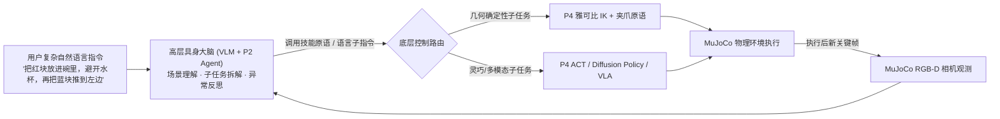

# 🏆 Project 5 (Capstone): 分层闭环具身智能体（LLM/VLM 大脑 + 技能/VLA 小脑，W14–W16）

> **终极作品定位**：将前 13 周所有积木**缝合成一个完整可演示的具身智能系统**——同时击中 **LLM、Agent、具身智能** 三大岗位 JD 的最高频交集（对标 SayCan / VoxPoser / Physical Intelligence *Hi Robot* 分层范式）。

---

## 系统架构图

---

## 两周核心攻坚清单

1. **W14 · 打通「感知 → 规划 → 执行」正向链路**：
   - 在 MuJoCo 桌面放置多色物块、碗与障碍物，利用相机内外参反投影或开放词汇检测提取 3D 锚点；
   - 接入你自部署的 VLM / P1 微调的指令解析模型，结合 P2 的 MCP 工具协议调用底层运动原语或 VLA 策略。
2. **W15 · 闭环视觉纠错与严谨消融实验（简历核心亮点）**：
   - 在仿真中故意注入扰动（例如抓取时物块滑落，或中途人为移动目标碗位置）；
   - 高层 VLM 对比动作前后图像检测失败原因（抓空 / 碰倒），触发重规划重试；
   - 跑满 20+ 条长程指令，填好下方消融实验表，并录制 30 秒对比 GIF 放进仓库首页！

## 📊 Capstone 消融实验表（面试必讲）

| 系统配置 | 单步指令成功率 (%) | 3步以上长程指令成功率 (%) | 注入扰动恢复率 (%) |
|---|---|---|---|
| 开环规划（只规划一次，无执行后视觉验证） | | | 0% |
| **闭环具身 Agent（VLM 状态验证 + 失败反思重规划）** | | | |
| 底层纯 IK 原语 vs **分层调用学习策略 / VLA** | | | |

