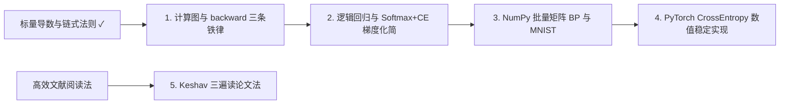

# w01-自动微分与P1

目标: 彻底吃透标量计算图反向传播与批量矩阵 BP（Softmax + 交叉熵化简、维度转置对齐、数值稳定性），打通 P1 NumPy/PyTorch MNIST 全链路
关联: ROADMAP_16W.md → W01（盲写 w01_micro_autograd.py + 项目 P1 MNIST + 论文 How to Read a Paper）
来源: concepts/w01_micro_autograd.py, concepts/w01_my_autograd.py, projects/p1-tiny-llm/src/w01_mlp_mnist.py, ../03-深度学习/模型笔记/01-多层感知机与反向传播.ipynb
状态: 进行中

## 依赖图

## 课程（每一步 = 一节 HTML 课）

- [ ] 1. 标量计算图与 `Value.backward()` 三条铁律 — 掌握标志: 能看着计算图说清顶层 `grad=1`、`+=` 多路梯度累加、DFS 逆拓扑序缺一不可的原因 → [课程页](lessons/0001-scalar-autograd-chain.html)
- [ ] 2. 从 Sigmoid 到 Softmax + 交叉熵灵魂梯度 $p - y$ — 掌握标志: 用 2×2 算例推通 $\partial L/\partial z_i = p_i - y_i$，解释为何比 MSE 不饱和
- [ ] 3. 从标量到矩阵：NumPy 两层 MLP 批量反向传播与维度对齐 — 掌握标志: 不用死背公式，仅靠 Shape 对齐秒写出 `dW2 = A1.T @ dZ2` 与 `dA1 = dZ2 @ W2.T`
- [ ] 4. PyTorch 工业级对照：Log-Sum-Exp 防溢出与 `nn.CrossEntropyLoss` — 掌握标志: 解释减 `max` 为何不改变概率却消除 `exp` 溢出，并跑通 MNIST ≥ 97%
- [ ] 5. Keshav《How to Read a Paper》三遍阅读法 — 掌握标志: 能用三句话区分 🟢 略读 30 分钟与 🔴 精读 2 小时的动作清单

## 复习

<!-- 复习后由 study.py learn reviewed 追加记录 -->
