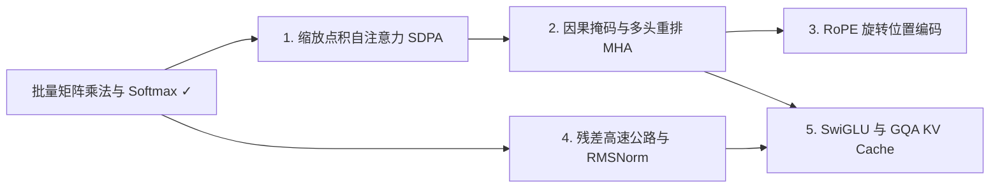

# w03-Transformer与现代LLM架构

目标: 从零推通缩放点积注意力、因果掩码与多头重排，吃透现代开源 LLM 四大标准积木（RoPE、RMSNorm + Pre-Norm 残差高速公路、SwiGLU 与 GQA KV Cache 账本）
关联: ROADMAP_16W.md → W02（ResNet 残差）+ W03（Attention 盲写与精读）+ W05（MiniMind 现代 LLM 架构拆解）
来源: ../04-LLM大模型/教学/01-自注意力.ipynb, ../04-LLM大模型/教学/02-多头注意力.ipynb, ../04-LLM大模型/教学/03-位置编码与RoPE.ipynb, ../04-LLM大模型/教学/05-层归一化LayerNorm.ipynb, ../04-LLM大模型/教学/08-注意力变种MQA与GQA.ipynb, ../04-LLM大模型/教学/09-MiniMind整体架构.ipynb
状态: 待开启

## 依赖图

## 课程（每一步 = 一节 HTML 课）

- [ ] 1. 缩放点积自注意力（SDPA）：$QK^\top / \sqrt{d_k}$ 方差推导与软检索直觉 — 掌握标志: 用 $T=3, d_k=2$ 算例手推注意力输出，并证明不除 $\sqrt{d_k}$ 为何导致方差为 $d_k$ 与 Softmax 梯度消失 → [课程页](lessons/0001-scaled-dot-product-attention.html)
- [ ] 2. 因果掩码（Causal Mask）与多头注意力（MHA）：防未来穿越与子空间并行 — 掌握标志: 说清上三角 $-\infty$ 为何必须在 Softmax 之前注入，并脱稿写出 `(B,T,C) -> (B,H,T,d_k)` 分头重排 → [课程页](lessons/0002-causal-mask-and-mha.html)
- [ ] 3. 旋转位置编码（RoPE）：复数平面旋转与相对位置内积不变性 — 掌握标志: 用 2D 旋转矩阵证出 $(R_m q)^\top (R_n k) = q^\top R_{n-m} k$，解释高低频波长分工 → [课程页](lessons/0003-rope-rotary-position-embedding.html)
- [ ] 4. 深层稳定器：残差梯度高速公路、Pre-Norm vs Post-Norm 与 RMSNorm — 掌握标志: 写出残差恒等项 $\partial x_L/\partial x_l = I + \dots$ 解释防退化，并对比 LayerNorm 与 RMSNorm 开销 → [课程页](lessons/0004-residual-rmsnorm-prenorm.html)
- [ ] 5. 现代 LLM 标准积木：SwiGLU 门控前馈网络与 GQA 分组查询省显存账本 — 掌握标志: 算清三矩阵 SwiGLU 隐藏维 $\frac{8}{3}d$ 参数对齐由来，并口算 7B 模型 MHA/GQA/MQA 的 KV Cache 显存 → [课程页](lessons/0005-swiglu-and-gqa-kv-cache.html)

## 复习

<!-- 复习后由 study.py learn reviewed 追加记录 -->
